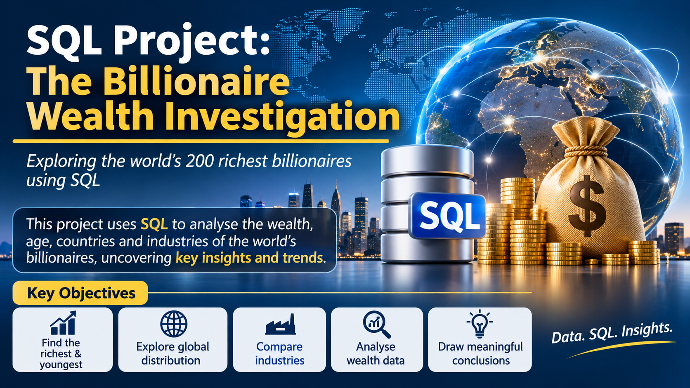

# The Billionaire Wealth Investigation

# 1.Project Overview

This project uses SQL to investigate the wealth, age, geographical distribution and industry representation of the world's 200 richest billionaires in the supplied dataset.
The analysis was conducted using SQLite Online. It demonstrates practical SQL skills in data retrieval, filtering, sorting, aggregation, grouping and subqueries.

# 2.Objectives
The project aims to:

1.Retrieve the 20 richest billionaires.

2.Identify the five youngest billionaires.

3.Calculate the average age and average net worth.

4.Identify the five most represented countries.

5.Calculate combined billionaire wealth by country.

6.Identify the five industries with the highest number of billionaires.

7.Identify countries with at least five billionaires.

8.Calculate the total wealth of billionaires younger than 50.

9.Identify billionaires whose net worth exceeds the overall average.

10.Identify the industry with the highest average net worth.

# 3.Dataset Description

The dataset contains 200 records and seven columns.

Column

Description

serial_number

Record identifier

rank

Billionaire ranking

name

Billionaire's name

age

Age in years

country

Country or region

networth_billion

Net worth in US$ billions

industry

Industry classification

# 4.Tools and Technologies

SQL

SQLite

SQLite Online

Microsoft Excel

GitHub

# 5.Data Quality Assessment

The following checks were performed:

Total records: 200

Missing values: None found

Duplicate serial numbers: None found

Blank names, countries or industries: None found

Zero or negative net worth values: None found

# 6.Key Findings

1. Wealth and Age

Average age: 69.38 years

Average net worth: US$31.84 billion

Youngest billionaire: Mark Mateschitz, aged 31

Number of billionaires younger than 50: 16

Combined wealth of billionaires younger than 50: US$508.3 billion

2. Geographical Distribution

The five most represented countries were:

Country

Number of billionaires

United States

79

China

17

India

13

Russia

11

Germany

11

The United States had the highest combined net worth at US$3,130.9 billion.

3. Industry Distribution

The five most represented industries were:

Industry

Number of billionaires

Technology

40

Finance & Investments

32

Fashion & Retail

30

Food & Beverage

15

Diversified

15

Technology was the most represented industry.

4. Wealth Above the Average

A total of 51 billionaires had net worth exceeding the overall average of US$31.84 billion.

5. Industry with the Highest Average Net Worth

Telecom recorded the highest average net worth at US$102 billion. However, this result was based on only one billionaire, so it should be interpreted cautiously.

# 7.SQL Skills Demonstrated

This project applies:

SELECT statements

WHERE conditions

ORDER BY

LIMIT

COUNT()

SUM()

AVG()

GROUP BY

HAVING

ROUND()

Subqueries

## 8. Project Files

| File | Description |
|---|---|
| [SQL Queries](Billionaire_Wealth_Investigation.sql) | SQL statements used in the investigation |
| [Excel Dataset](export%20from%20sqliteonline.com%20%282%29.xlsx) | Original dataset containing 200 records |
| [Project Report](Billionaire_Wealth_Investigation_Report.docx) | Formatted assignment report |

# Conclusion

The investigation demonstrates how SQL can be used to explore and analyse financial and demographic data.

The results show that billionaire wealth in this dataset is heavily concentrated in the United States, while Technology is the most represented industry.

This project strengthened practical skills in SQL-based data analysis, data validation, aggregation and interpretation of findings.
